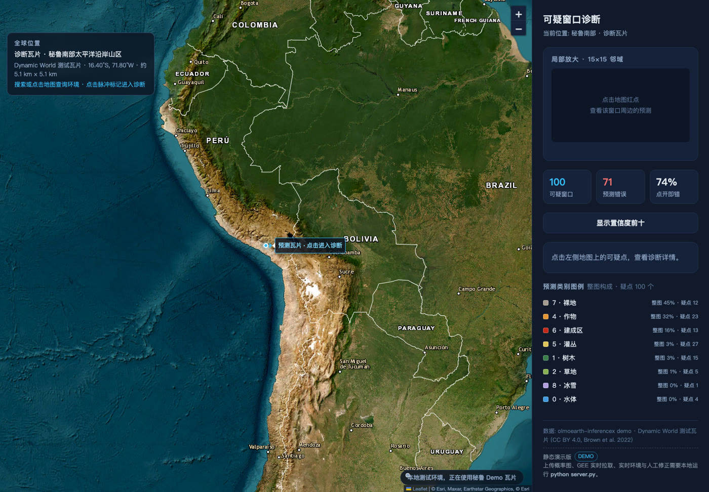
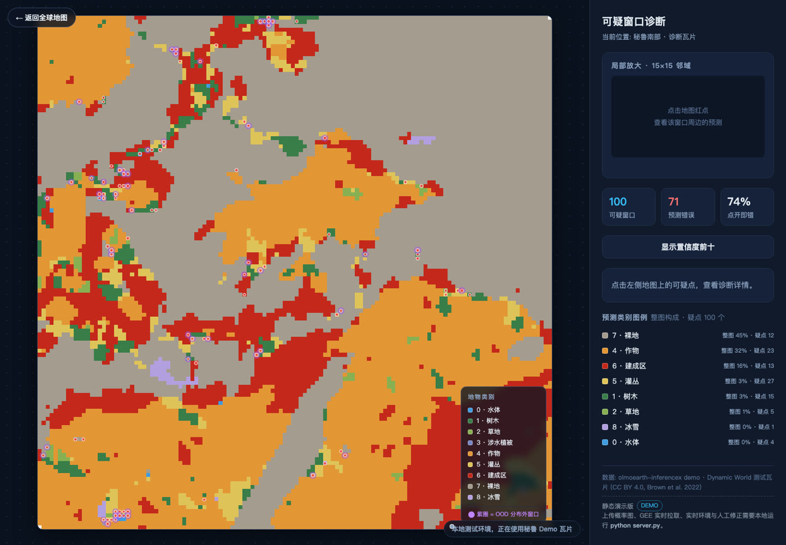

# Remote Sensing Map Audit — Suspicious Window Viewer

[](https://yuanzifang.github.io/remote-sensing-audit/)
[](LICENSE)
[](https://www.python.org/)

[中文 README](README.md) ｜ **English**

A label-free audit viewer for remote-sensing classification maps. It ranks the windows most worth human review using boundary and low-confidence cues, explains why each window is flagged, and lets you inspect them on a map.

No ground truth required to answer: *where is this map most likely wrong, and which windows should I check first?*

| Global context | Suspicious-window diagnosis |
| --- | --- |
|  |  |

**Live demo:** https://yuanzifang.github.io/remote-sensing-audit/ — the static build only includes browsing and diagnosis; upload, GEE fetch and live environment data require running `server.py` locally.

## What it does

- **Upload and audit** — accepts `.npy` probability maps, GeoTIFFs (9-band probabilities), and plain classified color maps (probabilities are inferred from the Dynamic World palette).
- **Review-set ranking** — orders windows by two label-free cues (boundary, low confidence) and produces 1% / 5% / 10% review sets.
- **Explainable** — every flagged window comes with the cue that triggered it and a confidence value, not just a score.
- **Map-linked UI** — click a window on the map to inspect its 15×15 neighborhood and class composition.
- **Built-in demo** — a tile from southern Peru with ground truth, so you can compare audit quality out of the box.
- **GEE export** — one command pulls real Dynamic World probabilities from Google Earth Engine.

## Quick start

```bash
git clone https://github.com/yuanzifang/remote-sensing-audit.git
cd remote-sensing-audit

# Dependencies (managed with uv, Python 3.13)
uv venv
uv pip install -r requirements.txt

# Local preview (defaults to port 8000, picks the next free port if busy)
python server.py
```

Open <http://127.0.0.1:8000>. The Peru demo loads by default; use the upload button to audit your own probability map.

## Project layout

```text
server.py            # Local preview server (stdlib): upload, run pipeline, serve results
index.html           # Page structure
script.js            # Map rendering, window list, zoom, legend
style.css            # Styles
prepare_data.py      # Audit output -> base_map.png / data.json / meta.json
image_to_prob.py     # Classified color map -> 9-class probabilities (palette distance)
gee_export.py        # Google Earth Engine -> Dynamic World probability GeoTIFF
inspect_outputs.py   # Debug helper for audit outputs
oe_inferencex_demo/  # Peru demo tile (probabilities, truth, audit results)
```

## Data and conventions

- **Classes:** Dynamic World 9-class scheme — water, trees, grass, flooded vegetation, crops, shrub/scrub, built area, bare ground, snow/ice.
- **Two probability sources**, always labeled in the UI:
  - **Real model output** — upload a `.npy` / GeoTIFF, or export one from Earth Engine with `gee_export.py`.
  - **Synthesized probabilities** — inferred from a classified color map by palette distance; for pipeline demos only, *not* a model's real confidence.
- **Audit engine:** [`olmoearth-inferencex`](https://pypi.org/project/olmoearth-inferencex/); `assess` produces review sets, cues and operating points.

## Pull real probabilities from Earth Engine

```bash
.venv/bin/earthengine authenticate          # one-time
.venv/bin/python gee_export.py \
  --lat 30.59 --lon 114.31 --date latest \
  --size-km 6 --scale 40 --project <your GEE project ID> \
  --out uploads/gee_dw.tif

python server.py                            # upload that GeoTIFF to audit it
```

## Known limitations

- Synthesized probabilities keep the pipeline runnable end to end; they must not be used to evaluate real model performance.
- Uploaded images are downscaled to 256 px on the longest side to keep browser rendering and auditing fast.
- Without ground truth the tool reports *review windows*, not accuracy. For an accuracy estimate, use a labeled sample with `estimate`.

## License

MIT © 2026 Fang Yuan
